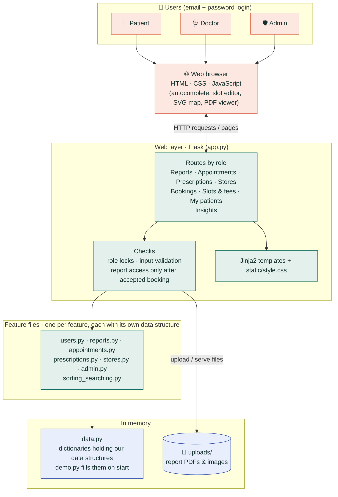

# CareMate: A Personalized Nurse Assistant

A Flask web app for **patients, doctors and admins** where every feature runs on a **data structure or algorithm written from scratch in Python**.
It uses no built-in `heapq`, `bisect` or `sorted()` for the core logic.
All data is kept in memory in our own data structures and goes back to the demo data when the app restarts.

## Features
### Patients
| Feature | What they can do |
|---|---|
| **Reports** | Upload reports (PDF/PNG/JPG), search, filter by type, sort, find reports between two dates or on an exact date, open files, delete their own uploads. Reports a doctor uploads appear here too |
| **Appointments** | See each doctor's free slots with the fee, pick an urgency (Emergency / Urgent / Routine), book, cancel. If a doctor is full, join the waiting list and get the next slot that opens |
| **Prescriptions** | A doctor's prescription appears the moment it's sent. Recent prescriptions are listed with *New* / *Active* badges, any one can be opened, and today's reminders come from every medicine still running |
| **Nearest medical stores** | Shortest road distance to every store around VIIT, Kondhwa, the route on a map, and which stores stock all the medicines they're taking now |

### Doctors
| Feature | What they can do |
|---|---|
| **Bookings** | Turn **auto-accept** on (bookings are confirmed instantly) or off (accept or decline each request). See the patient queue (day by day; within a day the most urgent first), call the next patient, and see the waiting list |
| **Slots & fees** | For any day, tick the time slots they offer and set that day's fee. Booked slots can't be removed |
| **My patients** | Once a booking is accepted, the doctor can open that patient's reports, **upload test reports** to them, and **write prescriptions** (with medicine autocomplete) that reach the patient immediately. They can withdraw their own newest prescription |

### Admins
| Feature | What they can do |
|---|---|
| **Insights** | Most booked doctors, most prescribed medicines, totals (patients, doctors, appointments, fees from completed visits), platform activity |

### Accounts
Everyone logs in with an email and password (passwords are stored hashed). **Anyone can sign up** as a patient or a doctor from the login page.

Demo accounts:

| Role | Email | Password |
|---|---|---|
| Patient (Siddhant Sancheti) | `siddhant@caremate.in` | `siddhant123` |
| Doctor (Dr. Arjun Patil) | `arjun@caremate.in` | `arjun123` |
| Admin | `admin@caremate.in` | `admin123` |

The map covers Kondhwa around VIIT (VIIT College, Kondhwa Budruk, Kondhwa Khurd, NIBM Road, Upper Indira Nagar, Bibvewadi, Katraj, Yewalewadi, Undri, Salunke Vihar) with 4 medical stores. Distances are approximate.

## Project files
Each feature has its own file, with the data structure it uses written by hand inside it.

| File | What it does | Data structure / algorithm |
|---|---|---|
| `app.py` | Web pages and routes (Flask) | |
| `data.py` | All the app's data (dictionaries holding our data structures) | |
| `demo.py` | Demo map, stores and logins | |
| `users.py` | Sign-up and login | Dictionaries |
| `reports.py` | Report library, reports between two dates | Doubly Linked List, Binary Search Tree |
| `appointments.py` | Slots, booking, doctor's queue, waiting list | Priority Queue, Queue |
| `prescriptions.py` | Prescriptions and daily reminders | Stack |
| `stores.py` | Nearest medical store | Graph |
| `admin.py` | Most booked doctors, most prescribed medicines | Merge sort |
| `sorting_searching.py` | Used by all the files above | Merge sort, quick sort, binary search, linear search |

## How to run (Windows)
```bash
cd "Course project\nurse_assistant"
python -m venv venv
venv\Scripts\activate
pip install -r requirements.txt
python app.py
```
Open **http://127.0.0.1:5000** in your browser.

The app runs **in memory** with demo data and starts fresh every time.

## System architecture

