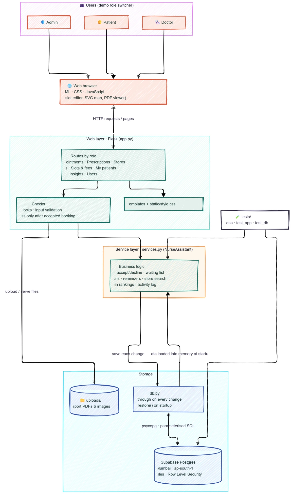

# CareMate: A Personalized Nurse Assistant

A Flask web app for **patients, doctors and admins** where every feature runs on a **data structure or algorithm written from scratch in Python**.
It uses no built-in `heapq`, `bisect` or `sorted()` for the core logic.
Data is **stored in Supabase (Postgres)** so it survives restarts, but every query still runs on our own data structures.

## Features
### Patients
| Feature | What they can do |
|---|---|
| **Reports** | Upload reports (PDF/PNG/JPG), search, filter by type, sort, find reports between two dates or on an exact date, open files, delete their own uploads. Reports a doctor uploads appear here too |
| **Appointments** | See each doctor's free slots with the fee, pick an urgency (Emergency / Urgent / Routine), book, cancel. If a doctor is full, join the waiting list and get the next slot that opens |
| **Prescriptions** | A doctor's prescription appears the moment it's sent. Recent prescriptions are listed with *New* / *Active* badges, any one can be opened, and today's reminders come from every medicine still running |
| **Nearest medical stores** | Shortest road distance to every store, the route on a map, and which stores stock all the medicines they're taking now |

### Doctors
| Feature | What they can do |
|---|---|
| **Bookings** | Turn **auto-accept** on (bookings are confirmed instantly) or off (accept or decline each request). See the patient queue (day by day; within a day the most urgent first), call the next patient, and see the waiting list |
| **Slots & fees** | For any day, tick the time slots they offer and set that day's fee. Booked slots can't be removed |
| **My patients** | Once a booking is accepted, the doctor can open that patient's reports, **upload test reports** to them, and **write prescriptions** (with medicine autocomplete) that reach the patient immediately. They can withdraw their own newest prescription |

### Admins
| Feature | What they can do |
|---|---|
| **Insights** | Most booked doctors, most prescribed medicines, totals (patients, doctors, appointments, fees from completed visits), platform activity |
| **Users** | Add, edit, deactivate and reactivate patients, doctors and admins. Deactivated users can't sign in or be booked; their records are kept |

> **Sign-in is a demo switcher** ("Signed in as" in the sidebar) with no passwords, so you can jump between roles during a presentation. Real logins would be needed before real patients use it.

## Which data structure powers what
| Feature | Data structure / algorithm | Complexity | File |
|---|---|---|---|
| Patients & doctors lookup | Hash Table | O(1) avg | `dsa/hash_table.py` |
| Reports library | Doubly Linked List | insert O(1) | `dsa/linked_list.py` |
| Reports between two dates | Binary Search Tree | O(h + k) | `dsa/bst.py` |
| Doctor's patient queue | Min-Heap Priority Queue | O(log n) | `dsa/heap.py` |
| Waiting list | Queue (FIFO) | O(1) | `dsa/queue_stack.py` |
| Prescription history | Stack (LIFO) | O(1) | `dsa/queue_stack.py` |
| Medicine autocomplete | Trie | O(P + K) | `dsa/trie.py` |
| Nearest medical store | Graph + Dijkstra | O((V+E) log V) | `dsa/graph.py` |

The **"Under the hood"** page in the app lists every structure and algorithm with live stats.

## How to run (Windows)
```bash
cd "Course project\nurse_assistant"
python -m venv venv
venv\Scripts\activate
pip install -r requirements.txt
python app.py
```
Open **http://127.0.0.1:5000** in your browser.

Without `supabase_config.ini` the app runs **in memory** with demo data and starts fresh every time.

## System architecture

